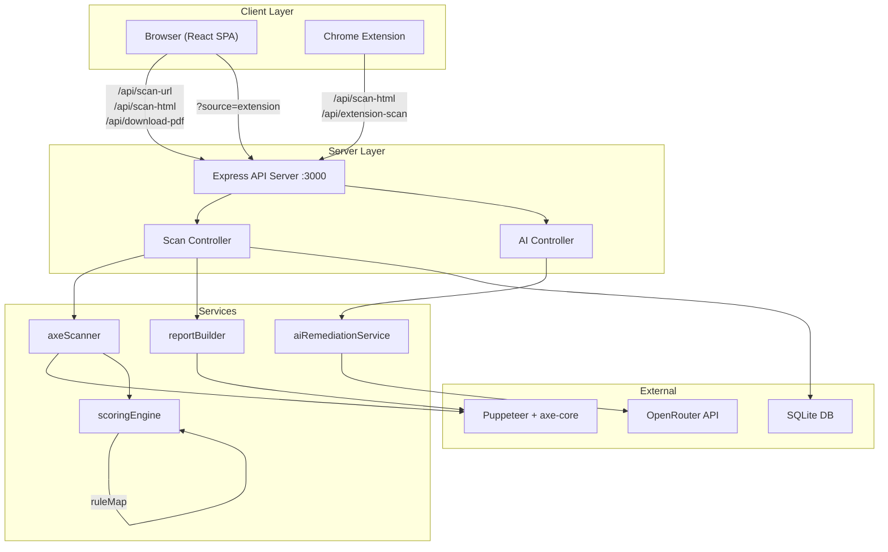
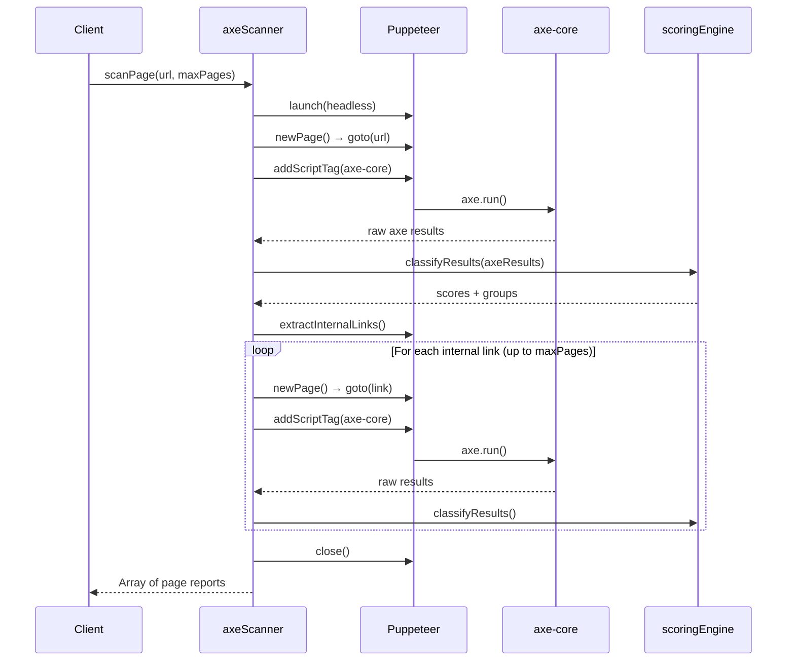
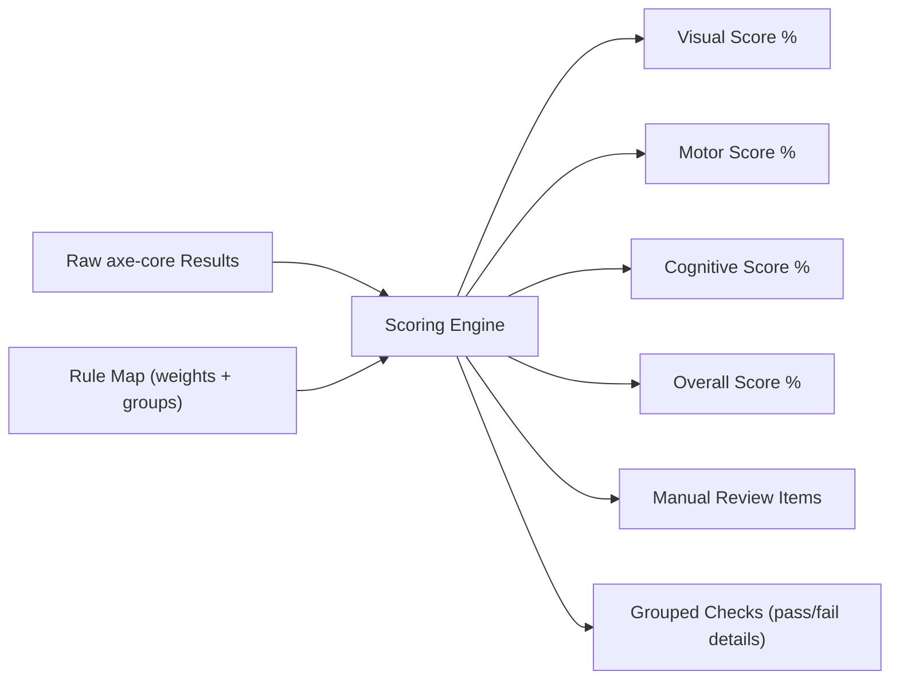
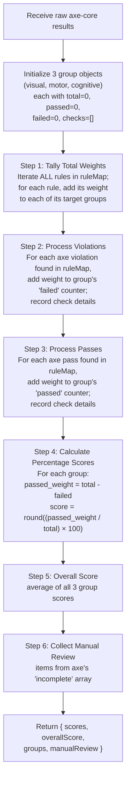
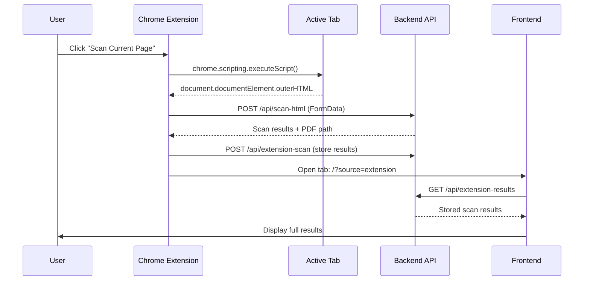
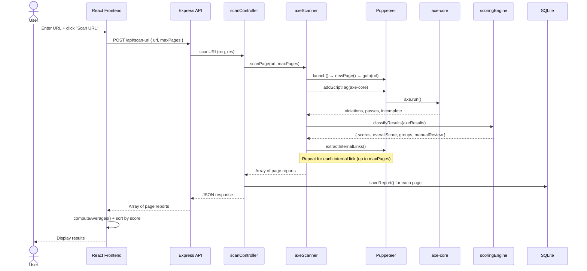
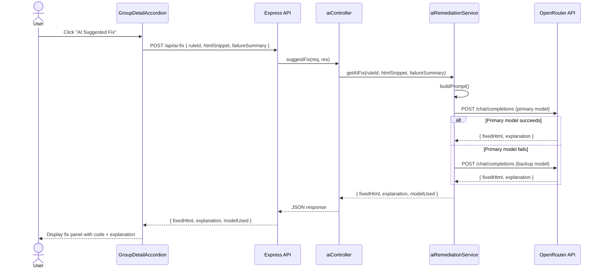

# Accessibility Checker RCC — System Documentation

> **Version**: 1.0.0  
> **Last Updated**: May 2026  
> **Engine**: axe-core v4.x · WCAG 2.1/2.2  

---

## Table of Contents

- [1. Project Overview](#1-project-overview)
- [2. System Architecture](#2-system-architecture)
- [3. Directory Structure](#3-directory-structure)
- [4. Tech Stack](#4-tech-stack)
- [5. Backend — Server](#5-backend--server)
  - [5.1 Entry Point (`app.js`)](#51-entry-point-appjs)
  - [5.2 Routes (`scanRoutes.js`)](#52-routes-scanroutesjs)
  - [5.3 Controllers](#53-controllers)
  - [5.4 Services](#54-services)
  - [5.5 Utilities](#55-utilities)
  - [5.6 Database (`db.js`)](#56-database-dbjs)
- [6. Scoring Engine — Deep Dive](#6-scoring-engine--deep-dive)
  - [6.1 Overview](#61-overview)
  - [6.2 The Rule Map](#62-the-rule-map)
  - [6.3 Scoring Algorithm Step-by-Step](#63-scoring-algorithm-step-by-step)
  - [6.4 Mathematical Formula](#64-mathematical-formula)
  - [6.5 Worked Examples](#65-worked-examples)
  - [6.6 Multi-Page Averaging](#66-multi-page-averaging)
  - [6.7 Score Interpretation & Thresholds](#67-score-interpretation--thresholds)
  - [6.8 Design Rationale](#68-design-rationale)
- [7. Frontend — Client](#7-frontend--client)
  - [7.1 Application Root (`App.jsx`)](#71-application-root-appjsx)
  - [7.2 Components](#72-components)
- [8. Chrome Extension](#8-chrome-extension)
- [9. API Reference](#9-api-reference)
- [10. Data Flow Sequences](#10-data-flow-sequences)
- [11. Configuration Reference](#11-configuration-reference)
- [12. Getting Started](#12-getting-started)

---

## 1. Project Overview

The **Accessibility Checker RCC** is a full-stack web application that enables users — including non-technical stakeholders, small teams, educators, and developers — to audit websites for WCAG 2.1/2.2 compliance without CLI tools or developer pipelines.

### Problem Addressed

As digital services become essential for education, employment, and government, inaccessible websites exclude millions of users with disabilities. Existing CLI tools like axe-core and pa11y are powerful but intimidating for non-developers. This project bridges that gap with a web-based UI that requires zero installation or technical expertise.

### Core Capabilities

| Capability | Description |
|---|---|
| **URL Scanning** | Enter any URL; the tool crawls internal links (depth 1) up to a configurable page limit and runs axe-core on each |
| **HTML Upload** | Upload a `.html` file for local scanning |
| **Disability-Group Scoring** | Violations classified into Visual, Motor, and Cognitive groups with weighted severity scoring |
| **AI Code Remediation** | Failed checks can be sent to an AI model (via OpenRouter) for automatic code-fix suggestions |
| **PDF Reports** | Generate and download professional A4 PDF reports of the full audit |
| **Chrome Extension** | Scan the currently-loaded authenticated page directly from the browser |
| **Persistent Storage** | Scan results stored in a local SQLite database for historical reference |

---

## 2. System Architecture



### Architectural Highlights

- **Monorepo structure**: A single root `package.json` orchestrates both `server/` and `client/` via `concurrently`.
- **API Proxy**: Vite dev server proxies `/api` and `/reports` to `localhost:3000`, enabling seamless local development.
- **Headless browser reuse**: Puppeteer serves dual purposes — running axe-core audits *and* rendering HTML-to-PDF reports.
- **Stateless extension bridge**: The Chrome extension captures DOM HTML, sends it as an upload, stores results server-side in memory, and redirects to the frontend dashboard.

---

## 3. Directory Structure

```
accessibility-checker-rcc/
├── package.json                    # Root monorepo orchestrator
├── Project Outline.md              # Original project specification
├── README.md                       # Existing project README
│
├── server/                         # Backend application
│   ├── package.json                # Server dependencies (Express, Puppeteer, axe-core, etc.)
│   ├── .env                        # Environment variables (API keys)
│   ├── .env.example                # Template for environment setup
│   ├── auditReports.db             # SQLite database file
│   ├── uploads/                    # Temporary directory for HTML file uploads
│   ├── public/
│   │   └── reports/                # Generated PDF report files
│   └── server/
│       ├── app.js                  # Express server entry point
│       ├── db.js                   # SQLite database module
│       ├── routes/
│       │   └── scanRoutes.js       # API route definitions
│       ├── controllers/
│       │   ├── scanController.js   # Scan & PDF request handlers
│       │   └── aiController.js     # AI remediation request handler
│       ├── services/
│       │   ├── axeScanner.js       # Puppeteer + axe-core scanning engine
│       │   ├── scoringEngine.js    # Weighted disability-group scoring
│       │   ├── reportBuilder.js    # HTML-to-PDF report generation
│       │   └── aiRemediationService.js  # OpenRouter AI integration
│       └── utils/
│           └── ruleMap.js          # axe-core rule → disability group mapping
│
├── client/                         # Frontend application
│   ├── package.json                # Client dependencies (React, Vite, Tailwind)
│   ├── vite.config.js              # Vite configuration with API proxy
│   ├── tailwind.config.js          # Tailwind CSS configuration
│   ├── index.html                  # SPA entry point
│   └── src/
│       ├── main.jsx                # React DOM mount
│       ├── App.jsx                 # Root application component
│       ├── App.css                 # Global app styles
│       ├── index.css               # Tailwind base imports
│       └── components/
│           ├── HeroSection.jsx         # Landing page hero & features
│           ├── InputPanel.jsx          # URL/HTML input forms
│           ├── ScoreSummary.jsx        # Score card grid
│           ├── GroupDetailAccordion.jsx # Disability group details & AI fixes
│           ├── ManualReviewSection.jsx # Manual review accordion
│           ├── PdfDownload.jsx         # PDF download button
│           └── LegislationSection.jsx  # Accessibility laws reference
│
└── extension/                      # Chrome browser extension
    ├── manifest.json               # Manifest V3 configuration
    ├── popup.html                  # Extension popup UI
    ├── popup.css                   # Popup styles
    ├── popup.js                    # Popup logic (scan & redirect)
    ├── options.html                # Extension settings page
    └── options.js                  # Settings persistence (chrome.storage)
```

---

## 4. Tech Stack

| Layer | Technologies |
|---|---|
| **Frontend** | React 19, Vite 7, Tailwind CSS 3, Lucide Icons |
| **Backend** | Node.js, Express 5, CommonJS modules |
| **Scanner** | Puppeteer 24 (headless Chromium), axe-core 4.10 |
| **PDF Generation** | Puppeteer (HTML template → `page.pdf()`) |
| **Database** | SQLite 3 (via `sqlite3` npm package) |
| **AI Remediation** | OpenRouter API (Nvidia Nemotron 3 Nano / Google Gemma 3 4B) |
| **Extension** | Chrome Manifest V3, chrome.scripting, chrome.storage |
| **Orchestration** | `concurrently` (parallel server + client) |

---

## 5. Backend — Server

### 5.1 Entry Point ([app.js](file:///c:/Users/jelag/Downloads/Einye/4.2/Proj/M2/accessibility-checker-rcc/server/server/app.js))

The Express server initializes with these responsibilities:

1. **Environment loading** — Reads `server/.env` for `OPENROUTER_API_KEY` using `dotenv`
2. **Middleware chain**:
   - CORS enabled for all origins
   - JSON body parsing with 100MB limit (for large scan payloads)
   - URL-encoded body parsing with 100MB limit
   - 5-minute request/response timeout for heavy PDF operations
3. **File uploads** — `multer` configured with destination `server/uploads/`
4. **Static files** — Serves generated PDFs from `server/public/reports/`
5. **Routes** — All API routes mounted under `/api`
6. **Database** — Initializes SQLite on startup

**Server runs on port 3000.**

---

### 5.2 Routes ([scanRoutes.js](file:///c:/Users/jelag/Downloads/Einye/4.2/Proj/M2/accessibility-checker-rcc/server/server/routes/scanRoutes.js))

| Method | Endpoint | Handler | Purpose |
|--------|----------|---------|---------|
| `POST` | `/api/scan-url` | `scanController.scanURL` | Scan a live URL + crawl internal links |
| `POST` | `/api/scan-html` | `scanController.scanHTML` | Scan an uploaded HTML file |
| `GET` | `/api/download-pdf` | `scanController.downloadPDF` | Re-scan URL and generate downloadable PDF |
| `POST` | `/api/extension-scan` | `scanController.storeExtensionResults` | Store extension scan results in memory |
| `GET` | `/api/extension-results` | `scanController.getExtensionResults` | Retrieve stored extension scan results |
| `POST` | `/api/ai-fix` | `aiController.suggestFix` | Request AI-generated code fix for a violation |

---

### 5.3 Controllers

#### [scanController.js](file:///c:/Users/jelag/Downloads/Einye/4.2/Proj/M2/accessibility-checker-rcc/server/server/controllers/scanController.js)

Orchestrates scan workflows:

- **`scanURL(req, res)`** — Validates URL, clamps `maxPages` to 1–50 range (default: 5), calls `axeScanner.scanPage()`, saves each page report to SQLite, returns the full array.
- **`scanHTML(req, res)`** — Reads uploaded file from `multer` temp path, calls `axeScanner.scanHTML()`, generates a PDF via `reportBuilder`, returns results with `pdfDownload` path, then deletes the temp file.
- **`downloadPDF(req, res)`** — Re-scans the given URL, generates a PDF, streams it as a file download.
- **`storeExtensionResults(req, res)`** / **`getExtensionResults(req, res)`** — Simple in-memory store for bridging the Chrome extension to the frontend dashboard.

#### [aiController.js](file:///c:/Users/jelag/Downloads/Einye/4.2/Proj/M2/accessibility-checker-rcc/server/server/controllers/aiController.js)

- **`suggestFix(req, res)`** — Validates required fields (`ruleId`, `htmlSnippet`, `failureSummary`), delegates to `aiRemediationService.getAIFix()`, returns the fixed HTML and explanation.

---

### 5.4 Services

#### [axeScanner.js](file:///c:/Users/jelag/Downloads/Einye/4.2/Proj/M2/accessibility-checker-rcc/server/server/services/axeScanner.js) — Scanning Engine

The scanner manages headless browser lifecycle and axe-core injection:

**`scanPage(url, maxPages)`** — URL scanning pipeline:



Key implementation details:
- **URL normalization** — Strips fragments, `utm_*` tracking params, `ref` params, and trailing slashes to avoid duplicate scanning
- **Deduplication** — Maintains a `Set` of visited normalized URLs
- **Timeouts** — Initial page: 60s, sub-pages: 30s
- **Error handling** — Sub-page failures are logged but don't abort the entire scan

**`scanHTML(html)`** — HTML upload scanning:
- Launches Puppeteer, sets page content via `page.setContent()`, runs axe-core, scores, and returns a single report.

---

#### [scoringEngine.js](file:///c:/Users/jelag/Downloads/Einye/4.2/Proj/M2/accessibility-checker-rcc/server/server/services/scoringEngine.js) — Scoring Engine

*Detailed in [Section 6](#6-scoring-engine--deep-dive).*

---

#### [reportBuilder.js](file:///c:/Users/jelag/Downloads/Einye/4.2/Proj/M2/accessibility-checker-rcc/server/server/services/reportBuilder.js) — PDF Report Generation

Generates professional A4 PDF reports using Puppeteer's `page.pdf()`:

1. **Normalizes input** — Handles both single report objects and arrays
2. **Ensures group completeness** — Initializes missing groups (visual/motor/cognitive) with empty defaults
3. **Builds HTML template** — A complete styled HTML document with:
   - Hero header (gradient blue) with title, audit date, page count, and engine version
   - Per-page score card grids (overall, visual, motor, cognitive) with color-coded backgrounds
   - Disability group breakdown sections with failed/passed checks
   - Rule cards with impact badges (critical/serious/moderate/minor), descriptions, "Learn more" links, and HTML code snippets
   - Manual review section (amber-themed) with flagged items or default recommendations
   - Footer with copyright and generation notice
4. **Renders to PDF** — Opens Puppeteer, renders HTML, exports as A4 PDF with 40px top/bottom, 30px left/right margins
5. **Saves file** — Stored in `server/public/reports/` with timestamped filename (`report-<timestamp>.pdf`)

**Timeouts**: 2-minute timeout on browser launch, page operations, and PDF generation.

---

#### [aiRemediationService.js](file:///c:/Users/jelag/Downloads/Einye/4.2/Proj/M2/accessibility-checker-rcc/server/server/services/aiRemediationService.js) — AI Remediation

Provides AI-powered code fix suggestions using the OpenRouter API:

**Architecture**:
- **Primary model**: `nvidia/nemotron-3-nano-30b-a3b:free` — fast, capable
- **Backup model**: `google/gemma-3-4b-it:free` — fallback if primary is unavailable
- **Temperature**: 0.2 (low, for deterministic and accurate fixes)
- **Max tokens**: 1,024

**Workflow**:
1. Validates that `OPENROUTER_API_KEY` is configured
2. Builds a structured prompt with the rule ID, failure summary, and offending HTML snippet
3. Attempts the primary model; on failure, falls back to the backup model
4. Strips any accidental markdown code fences from the response
5. Parses the JSON response to extract `fixedHtml` and `explanation`
6. Returns `{ fixedHtml, explanation, modelUsed }`

---

### 5.5 Utilities

#### [ruleMap.js](file:///c:/Users/jelag/Downloads/Einye/4.2/Proj/M2/accessibility-checker-rcc/server/server/utils/ruleMap.js) — Rule Mapping

*Detailed in [Section 6.2](#62-the-rule-map).*

---

### 5.6 Database ([db.js](file:///c:/Users/jelag/Downloads/Einye/4.2/Proj/M2/accessibility-checker-rcc/server/server/db.js))

SQLite database stored at `server/auditReports.db`.

**Schema**:
```sql
CREATE TABLE IF NOT EXISTS reports (
    id        INTEGER PRIMARY KEY AUTOINCREMENT,
    url       TEXT,
    report    TEXT,       -- JSON-stringified full report
    timestamp TEXT        -- ISO 8601 timestamp
);
```

**Operations**:

| Function | Description |
|----------|-------------|
| `initDB()` | Opens/creates the database and ensures the `reports` table exists |
| `saveReport(url, reportJSON)` | Inserts a new report (JSON-stringified) with ISO 8601 timestamp |
| `getLatestReportByURL(url, callback)` | Retrieves and parses the most recent report for a given URL |

---

## 6. Scoring Engine — Deep Dive

### 6.1 Overview

The Scoring Engine ([scoringEngine.js](file:///c:/Users/jelag/Downloads/Einye/4.2/Proj/M2/accessibility-checker-rcc/server/server/services/scoringEngine.js)) is the heart of the system's evaluation logic. It takes raw axe-core audit results and produces **weighted accessibility scores** for three disability groups — **Visual**, **Motor**, and **Cognitive** — along with an **overall compliance score**.

The engine answers the question: *"How accessible is this page, and for whom?"*



---

### 6.2 The Rule Map

The Rule Map ([ruleMap.js](file:///c:/Users/jelag/Downloads/Einye/4.2/Proj/M2/accessibility-checker-rcc/server/server/utils/ruleMap.js)) is the foundational data structure that drives all scoring. It is a dictionary mapping each **axe-core rule ID** to:
- **`groups`**: An array of disability categories the rule affects (`visual`, `motor`, `cognitive`)
- **`weight`**: A severity integer from 1 to 3

> [!IMPORTANT]
> Only rules present in the Rule Map are included in scoring. Any axe-core rules not listed here are **silently ignored** by the scoring engine.

#### Weight Scale

| Weight | Severity | Description | Example Rules |
|--------|----------|-------------|---------------|
| **3** | **High** | Critical barrier — blocks entire user groups | `color-contrast`, `image-alt`, `focus-visible`, `keyboard`, `meta-refresh` |
| **2** | **Medium** | Significant issue — degrades usability | `document-title`, `html-has-lang`, `tabindex`, `duplicate-id`, `iframe-title` |
| **1** | **Low** | Minor issue — inconvenient but not blocking | `aria-valid-attr`, `region`, `accesskeys`, `aria-roles`, `meta-viewport` |

#### Multi-Group Rules

Some rules affect multiple disability groups simultaneously. When a multi-group rule fails, its weight is deducted from **each** group it belongs to:

| Rule ID | Groups | Weight | Rationale |
|---------|--------|--------|-----------|
| `link-name` | visual, motor, cognitive | 3 | Links without text affect screen readers, keyboard users, and cognitive clarity |
| `button-name` | motor, cognitive | 3 | Unlabeled buttons affect keyboard navigation and comprehension |
| `label` | visual, cognitive | 3 | Form labels are critical for screen readers and cognitive understanding |
| `document-title` | visual, cognitive | 2 | Page titles orient screen reader users and help cognitive navigation |
| `heading-order` | visual, cognitive | 2 | Heading structure aids both screen reader navigation and cognitive flow |
| `bypass` | motor, cognitive | 2 | Skip links help keyboard users and reduce cognitive overhead |

#### Complete Rule Inventory

##### Visual Impairment Rules (25 rules)

| Rule ID | Weight | Description |
|---------|--------|-------------|
| `color-contrast` | 3 | Text must have sufficient color contrast ratio |
| `image-alt` | 3 | Images must have alternative text |
| `label` | 3 | Form inputs must have labels |
| `color-contrast-enhanced` | 2 | Enhanced contrast ratio (best practice) |
| `object-alt` | 2 | `<object>` elements must have alt text |
| `input-image-alt` | 2 | Image inputs must have alt text |
| `area-alt` | 2 | `<area>` elements must have alt text |
| `svg-img-alt` | 2 | SVG images must have accessible names |
| `role-img-alt` | 2 | Elements with `role="img"` must have alt text |
| `heading-order` | 2 | Heading levels should increase by one |
| `page-has-heading-one` | 2 | Page must have a level-one heading |
| `document-title` | 2 | Pages must have a `<title>` |
| `html-has-lang` | 2 | `<html>` must have a `lang` attribute |
| `link-in-text-block` | 2 | Links must be distinguishable from surrounding text |
| `link-name` | 2 | Links must have discernible text |
| `empty-heading` | 2 | Headings must not be empty |
| `image-redundant-alt` | 1 | Image alt text should not duplicate adjacent text |
| `alt-space-value` | 1 | Alt attributes should not be just whitespace |
| `form-field-multiple-labels` | 1 | Form fields should not have multiple labels |
| `aria-label` | 1 | ARIA labels must be valid |
| `html-lang-valid` | 1 | `lang` attribute must have a valid value |
| `html-xml-lang-mismatch` | 1 | `xml:lang` and `lang` must match |
| `p-as-heading` | 1 | `<p>` should not be used as headings |
| `aria-allowed-attr` | 1 | ARIA attributes must be valid for the element role |
| `aria-valid-attr` | 1 | ARIA attributes must be valid |
| `aria-valid-attr-value` | 1 | ARIA attribute values must be valid |

##### Motor Impairment Rules (14 rules)

| Rule ID | Weight | Description |
|---------|--------|-------------|
| `focus-visible` | 3 | Focus indicator must be visible for keyboard users |
| `button-name` | 3 | Buttons must have accessible names |
| `keyboard` | 3 | All functionality must be keyboard accessible |
| `no-keyboard-trap` | 3 | No keyboard traps may exist |
| `focus-order-semantics` | 2 | Focus order must follow semantic structure |
| `tabindex` | 2 | Tab order should be logical |
| `bypass` | 2 | Page must have a way to skip repetitive content |
| `skip-link` | 2 | Skip navigation links should be present |
| `landmark-one-main` | 2 | Page must have one `<main>` landmark |
| `landmark-unique` | 2 | Landmarks must have unique roles or labels |
| `link-name` | 2 | Links must have discernible text |
| `scrollable-region-focusable` | 2 | Scrollable regions must be keyboard accessible |
| `region` | 1 | Content should be in landmark regions |
| `accesskeys` | 1 | Access keys must be unique |

##### Cognitive Impairment Rules (19 rules)

| Rule ID | Weight | Description |
|---------|--------|-------------|
| `meta-refresh` | 3 | Pages should not auto-refresh |
| `blink` | 3 | `<blink>` element must not be used |
| `marquee` | 3 | `<marquee>` element must not be used |
| `link-name` | 3 | Links must have discernible text |
| `button-name` | 3 | Buttons must have accessible names |
| `duplicate-id` | 2 | Element IDs must be unique |
| `duplicate-id-active` | 2 | Active element IDs must be unique |
| `duplicate-id-aria` | 2 | ARIA-referenced IDs must be unique |
| `aria-command-name` | 2 | ARIA command elements must have names |
| `aria-input-field-name` | 2 | ARIA input fields must have names |
| `aria-toggle-field-name` | 2 | ARIA toggle fields must have names |
| `autocomplete-valid` | 2 | Autocomplete attributes must be valid |
| `aria-hidden-focus` | 2 | `aria-hidden` elements must not have focusable children |
| `aria-dialog-name` | 2 | ARIA dialogs must have accessible names |
| `frame-title` | 2 | `<frame>` elements must have titles |
| `iframe-title` | 2 | `<iframe>` elements must have titles |
| `label-title-only` | 1 | Form labels should not rely on `title` alone |
| `form-field-multiple-labels` | 1 | Form fields should not have multiple labels |
| `aria-roles` | 1 | ARIA roles must be valid |
| `aria-required-children` | 1 | ARIA parent roles must have required children |
| `aria-required-parent` | 1 | ARIA child roles must have required parents |
| `meta-viewport` | 1 | Meta viewport should not disable zoom |

> [!NOTE]
> Due to JavaScript object key semantics, some rules that appear in both a single-group section and the "shared" section at the bottom of `ruleMap.js` are effectively overridden by the last definition. For example, `link-name` is defined first as `{ groups: ['visual'], weight: 2 }`, then again as `{ groups: ['motor'], weight: 2 }`, and finally as `{ groups: ['visual', 'motor', 'cognitive'], weight: 3 }`. **Only the last definition takes effect.** The same applies to `button-name`, `label`, `document-title`, `heading-order`, and `bypass`.

---

### 6.3 Scoring Algorithm Step-by-Step

The scoring algorithm in [classifyResults()](file:///c:/Users/jelag/Downloads/Einye/4.2/Proj/M2/accessibility-checker-rcc/server/server/services/scoringEngine.js#L3-L94) proceeds as follows:



**Detailed breakdown**:

#### Step 1 — Tally Total Weights

The engine iterates over **every rule** in the `ruleMap` (not just those found in the scan results) and sums the weight for each group. This establishes the **maximum possible score** per group — the theoretical ceiling against which failures are measured.

```javascript
for (const [ruleId, data] of Object.entries(ruleMap)) {
    const { groups: targetGroups, weight } = data;
    for (const group of targetGroups) {
        groups[group].total += weight;
    }
}
```

> [!IMPORTANT]
> The total is calculated from the **full rule map**, not just the rules that appear in the scan results. This means the denominator is constant regardless of what axe-core finds, ensuring consistent and comparable scores across different pages.

#### Step 2 — Process Violations

For each violation reported by axe-core, the engine checks if the rule exists in the `ruleMap`. If found, it adds the rule's weight to the group's `failed` counter and records the full check details (rule ID, description, help URL, impact severity, and all affected HTML node snippets).

#### Step 3 — Process Passes

Same logic as violations, but adds to the `passed` counter. Note: **the `passed` counter is tracked but not directly used in the score formula** — the score is derived from `total - failed`.

#### Step 4 — Calculate Percentage Scores

For each group:
```
passed_weight = total_weight − failed_weight
score = round((passed_weight / total_weight) × 100)
```

If a group has zero total weight (no rules mapped), it scores **100%** by default.

#### Step 5 — Overall Score

The overall score is the **simple arithmetic mean** of the three group percentages:
```
overallScore = round((visual_score + motor_score + cognitive_score) / 3)
```

#### Step 6 — Manual Review Collection

Items from axe-core's `incomplete` array (checks that could not be fully automated) are collected as manual review items with their rule ID, description, help URL, and affected HTML.

---

### 6.4 Mathematical Formula

The scoring model can be expressed formally:

Let:
- **R** = set of all rules in the ruleMap
- **R_g** = subset of rules belonging to group *g* (where *g* ∈ {visual, motor, cognitive})
- **w(r)** = weight of rule *r*
- **V** = set of violated rules found by axe-core that exist in the ruleMap

**Per-group score**:

$$
\text{Score}_g = \text{round}\left(\frac{\sum_{r \in R_g} w(r) - \sum_{r \in V \cap R_g} w(r)}{\sum_{r \in R_g} w(r)} \times 100\right)
$$

Which simplifies to:

$$
\text{Score}_g = \text{round}\left(\frac{T_g - F_g}{T_g} \times 100\right)
$$

Where:
- **T_g** = total weight for group *g* (constant, derived from the full ruleMap)
- **F_g** = failed weight for group *g* (sum of weights of violated rules in this group)

**Overall score**:

$$
\text{Overall} = \text{round}\left(\frac{\text{Score}_\text{visual} + \text{Score}_\text{motor} + \text{Score}_\text{cognitive}}{3}\right)
$$

---

### 6.5 Worked Examples

#### Example 1: A page with minor visual issues

Assume the effective ruleMap yields these group totals:
- **Visual total weight**: 46 (sum of all visual rule weights)
- **Motor total weight**: 31 (sum of all motor rule weights)
- **Cognitive total weight**: 38 (sum of all cognitive rule weights)

If `color-contrast` (weight 3) and `image-alt` (weight 3) both fail — both are visual-only:

```
Visual:
  failed_weight  = 3 + 3 = 6
  passed_weight  = 46 − 6 = 40
  visual_score   = round((40 / 46) × 100) = round(86.96) = 87%

Motor:
  failed_weight  = 0
  motor_score    = round((31 / 31) × 100) = 100%

Cognitive:
  failed_weight  = 0
  cognitive_score = round((38 / 38) × 100) = 100%

Overall: round((87 + 100 + 100) / 3) = round(95.67) = 96%
```

#### Example 2: A multi-group rule failure

If `link-name` (weight 3, groups: visual + motor + cognitive) fails:

```
Visual:   failed = 3  →  score = round(((46 − 3) / 46) × 100) = round(93.48) = 93%
Motor:    failed = 3  →  score = round(((31 − 3) / 31) × 100) = round(90.32) = 90%
Cognitive: failed = 3 →  score = round(((38 − 3) / 38) × 100) = round(92.11) = 92%

Overall: round((93 + 90 + 92) / 3) = round(91.67) = 92%
```

#### Example 3: Severe multi-rule failures

If `color-contrast` (visual, 3), `keyboard` (motor, 3), `no-keyboard-trap` (motor, 3), `meta-refresh` (cognitive, 3), and `link-name` (all groups, 3) all fail:

```
Visual:   failed = 3 + 3 = 6     →  score = round(((46 − 6) / 46) × 100) = 87%
Motor:    failed = 3 + 3 + 3 = 9 →  score = round(((31 − 9) / 31) × 100) = 71%
Cognitive: failed = 3 + 3 = 6    →  score = round(((38 − 6) / 38) × 100) = 84%

Overall: round((87 + 71 + 84) / 3) = round(80.67) = 81%
```

---

### 6.6 Multi-Page Averaging

When multiple pages are scanned (URL crawling), the frontend computes **averaged scores** across all pages in [App.jsx](file:///c:/Users/jelag/Downloads/Einye/4.2/Proj/M2/accessibility-checker-rcc/client/src/App.jsx#L82-L106):

```javascript
const computeAverages = (reports) => {
    const totals = { overall: 0, visual: 0, motor: 0, cognitive: 0 };
    let validReports = 0;
    reports.forEach(r => {
        if (r && r.overallScore != null && r.scores) {
            totals.overall += r.overallScore;
            totals.visual += r.scores.visual;
            totals.motor += r.scores.motor;
            totals.cognitive += r.scores.cognitive;
            validReports++;
        }
    });
    const count = validReports || 1;
    return {
        overall: Math.round(totals.overall / count),
        groups: {
            visual: Math.round(totals.visual / count),
            motor: Math.round(totals.motor / count),
            cognitive: Math.round(totals.cognitive / count),
        },
    };
};
```

The averaged scores are displayed in a summary card above the individual page results.

---

### 6.7 Score Interpretation & Thresholds

Scores are interpreted and color-coded at three threshold levels, used consistently across the frontend UI and PDF reports:

| Score Range | Rating | Color Code | Interpretation |
|-------------|--------|------------|----------------|
| **90–100%** | Excellent | 🟢 Green (`bg-green-50`, `text-green-700`) | Minimal issues — page meets or exceeds standards |
| **70–89%** | Needs Attention | 🟡 Yellow (`bg-yellow-50`, `text-yellow-700`) | Some violations present — remediation recommended |
| **< 70%** | Poor | 🔴 Red (`bg-red-50`, `text-red-700`) | Significant accessibility gaps — urgent attention needed |

The color-coding logic from [ScoreSummary.jsx](file:///c:/Users/jelag/Downloads/Einye/4.2/Proj/M2/accessibility-checker-rcc/client/src/components/ScoreSummary.jsx#L2-L6):

```javascript
const getScoreColor = (score) => {
    if (score >= 90) return 'text-green-700 bg-green-50 border-green-200';
    if (score >= 70) return 'text-yellow-700 bg-yellow-50 border-yellow-200';
    return 'text-red-700 bg-red-50 border-red-200';
};
```

---

### 6.8 Design Rationale

Key design decisions in the scoring model:

1. **Weight-based, not count-based** — A `color-contrast` failure (weight 3) has 3× the impact of an `aria-roles` failure (weight 1). This reflects real-world impact: a critical barrier that blocks an entire user group should penalize more heavily than a minor inconvenience.

2. **Constant denominator** — The total weight for each group is derived from the **full rule map**, not just the rules found in the scan. This ensures:
   - Scores are comparable across different pages (same baseline)
   - An "empty" page with no checkable rules scores 100% (safe default)
   - Adding rules to the map shifts the baseline for all future scans

3. **Subtractive model** — Score is computed as `(total − failed) / total`, meaning a page starts at 100% and is penalized for failures. This is intuitive: "how close is this page to perfect accessibility?"

4. **Equal group weighting** — The overall score gives equal weight (1/3) to each disability group, even though the groups have different total rule counts. This ensures no single disability category dominates the overall assessment.

5. **Rules not in the map are ignored** — axe-core reports many rules that may not clearly map to a disability group. Rather than assigning arbitrary groupings, the system only scores rules with curated mappings, prioritizing accuracy over coverage.

---

## 7. Frontend — Client

The frontend is a React 19 single-page application built with Vite 7 and styled with Tailwind CSS 3.

### 7.1 Application Root ([App.jsx](file:///c:/Users/jelag/Downloads/Einye/4.2/Proj/M2/accessibility-checker-rcc/client/src/App.jsx))

The root component manages:
- **Global state**: `reports` (scan results array), `loading`, `error`
- **Scan orchestration**: `runUrlScan()` and `runHtmlUpload()` call the backend API
- **Multi-page averaging**: `computeAverages()` calculates mean scores across pages
- **Result sorting**: Multi-page results are sorted in **descending order** by overall score
- **Extension integration**: On `?source=extension` URL parameter, fetches results from `/api/extension-results`
- **Conditional rendering**: Shows landing page (hero + legislation) when no scan results exist, or the results view with scores, accordions, and PDF download

---

### 7.2 Components

#### [HeroSection.jsx](file:///c:/Users/jelag/Downloads/Einye/4.2/Proj/M2/accessibility-checker-rcc/client/src/components/HeroSection.jsx) — Landing Page

Displays when no scan results are loaded:
- **Welcome banner** with tagline and description
- **How-to steps** (3-step flow: Submit Source → Automated Audit → Remediate & Export)
- **Feature cards** (6 cards: URL Scanning, HTML Upload, Deep Crawling, AI Remediation, PDF Reports, Chrome Extension)
- Includes link to download the Chrome extension

#### [InputPanel.jsx](file:///c:/Users/jelag/Downloads/Einye/4.2/Proj/M2/accessibility-checker-rcc/client/src/components/InputPanel.jsx) — Scan Input Forms

Two side-by-side form cards:
- **URL Input**: Text field + page count selector (1/3/5/10/15/20/30/50 pages) + "Scan URL" button
- **HTML Upload**: File picker (`.html` only) + "Scan HTML" button
- **Informational banner**: Links to axe-core, WCAG guidelines, and axe DevTools

#### [ScoreSummary.jsx](file:///c:/Users/jelag/Downloads/Einye/4.2/Proj/M2/accessibility-checker-rcc/client/src/components/ScoreSummary.jsx) — Score Cards

Renders a 4-card grid (Overall, Visual, Motor, Cognitive) with:
- Percentage scores in large bold text
- Color-coded backgrounds (green/yellow/red) based on thresholds
- "Average Summary" label when displaying multi-page averages

#### [GroupDetailAccordion.jsx](file:///c:/Users/jelag/Downloads/Einye/4.2/Proj/M2/accessibility-checker-rcc/client/src/components/GroupDetailAccordion.jsx) — Disability Group Details

The most complex component, providing nested accordion views:

- **Top level**: Expandable disability group accordion (Visual / Motor / Cognitive)
- **Second level**: 
  - **Failed Checks** (red-themed) — Each failed rule shows:
    - Rule ID and impact severity badge
    - Description and "Learn more" link (to Deque University)
    - Expandable code snippets showing affected HTML elements
    - **AI Suggested Fix button** — Triggers `/api/ai-fix` and displays:
      - Fixed HTML code block with copy-to-clipboard functionality
      - Explanation of what was changed and why
      - Model attribution (which AI model was used)
  - **Passed Checks** (green-themed) — Same detail minus the AI fix button

#### [ManualReviewSection.jsx](file:///c:/Users/jelag/Downloads/Einye/4.2/Proj/M2/accessibility-checker-rcc/client/src/components/ManualReviewSection.jsx) — Manual Review

Amber-themed accordion section that displays:
- Items from axe-core's `incomplete` array (automated checks that need human verification)
- If no incomplete items: default recommendations (keyboard traps, focus order, cognitive load)

#### [PdfDownload.jsx](file:///c:/Users/jelag/Downloads/Einye/4.2/Proj/M2/accessibility-checker-rcc/client/src/components/PdfDownload.jsx) — PDF Download

A green download button that:
- **URL scans**: Triggers `/api/download-pdf?url=...` for a re-scan and PDF generation
- **HTML uploads**: Links directly to the already-generated PDF file path

#### [LegislationSection.jsx](file:///c:/Users/jelag/Downloads/Einye/4.2/Proj/M2/accessibility-checker-rcc/client/src/components/LegislationSection.jsx) — Laws & Standards

Two-column reference grid:
- **Kenyan Legal Frameworks**: Constitution of Kenya 2010 (Article 54), Persons with Disabilities Act 2003, ICT Authority Accessibility Guidelines, Kenya Information & Communications Act
- **Global Compliance Guidelines**: WCAG 2.1/2.2, European EN 301549:2021, ADA Section 508, EU Web Accessibility Directive

Each entry includes a title, description, and external link to the source document.

---

## 8. Chrome Extension

The Chrome extension ([extension/](file:///c:/Users/jelag/Downloads/Einye/4.2/Proj/M2/accessibility-checker-rcc/extension)) enables scanning of authenticated or dynamically-rendered pages that cannot be reached by server-side Puppeteer.

### Architecture



### Manifest V3 Configuration

| Property | Value |
|----------|-------|
| Manifest version | 3 |
| Permissions | `activeTab`, `scripting`, `storage` |
| Popup | `popup.html` |
| Options page | `options.html` |

### Key Behaviors

- **DOM capture**: Uses `chrome.scripting.executeScript()` to capture `document.documentElement.outerHTML` from the active tab — this captures the page *as rendered*, including JavaScript-generated content and authenticated state
- **Upload as HTML**: Wraps captured HTML in a `Blob` and sends it via `FormData` to `/api/scan-html`
- **Result bridging**: After receiving scan results, the extension POSTs them to `/api/extension-scan` (server-side in-memory store), then opens the frontend dashboard with `?source=extension` query parameter
- **Configurable URLs**: Backend and frontend URLs are configurable via the extension's options page (defaults: `localhost:3000` and `localhost:5173`)

### Security Design

> [!NOTE]
> The extension-based scanning approach was chosen specifically to avoid handling sensitive credentials. Rather than providing login forms that would require the server to manage usernames/passwords, the extension scans pages the user has **already authenticated to** in their browser. The server never sees credentials — only the rendered HTML.

---

## 9. API Reference

All endpoints are prefixed with `/api`. The backend runs on port `3000`.

### `POST /api/scan-url`

Scan a live URL and its internal links.

**Request**:
```json
{
    "url": "https://example.com",
    "maxPages": 5
}
```

| Field | Type | Required | Default | Description |
|-------|------|----------|---------|-------------|
| `url` | string | ✅ | — | Target URL to scan |
| `maxPages` | integer | ❌ | 5 | Maximum pages to crawl (clamped: 1–50) |

**Response** (200): Array of page reports
```json
[
    {
        "url": "https://example.com",
        "scannedAt": "2026-05-28T12:00:00.000Z",
        "overallScore": 85,
        "scores": {
            "visual": 90,
            "motor": 80,
            "cognitive": 85
        },
        "groups": {
            "visual": {
                "total": 46,
                "passed": 40,
                "failed": 6,
                "failedChecks": [
                    {
                        "rule": "color-contrast",
                        "description": "Elements must meet minimum color contrast ratio thresholds",
                        "helpUrl": "https://dequeuniversity.com/rules/axe/4.10/color-contrast",
                        "impact": "serious",
                        "html": ["<p style=\"color: #aaa;\">Low contrast text</p>"]
                    }
                ],
                "passedChecks": [...]
            },
            "motor": { ... },
            "cognitive": { ... }
        },
        "manualReview": [
            {
                "rule": "color-contrast",
                "description": "...",
                "helpUrl": "...",
                "html": ["..."]
            }
        ],
        "results": { /* raw axe-core output */ }
    }
]
```

**Error** (400): `{ "error": "URL is required" }`  
**Error** (500): `{ "error": "Scan failed", "message": "..." }`

---

### `POST /api/scan-html`

Scan an uploaded HTML file.

**Request**: `multipart/form-data` with field name `htmlFile`

**Response** (200): Single report object (same structure as URL scan, plus `pdfDownload`):
```json
{
    "fromHTML": true,
    "scannedAt": "2026-05-28T12:00:00.000Z",
    "overallScore": 92,
    "scores": { ... },
    "groups": { ... },
    "manualReview": [ ... ],
    "pdfDownload": "/reports/report-1748433600000.pdf"
}
```

---

### `GET /api/download-pdf?url=<encoded-url>`

Re-scans the given URL and generates a downloadable PDF report.

| Param | Type | Description |
|-------|------|-------------|
| `url` | string | URL to scan and generate report for |

**Response**: PDF file download (`accessibility-report.pdf`)

**Timeout**: 5-minute response timeout for large multi-page scans.

---

### `POST /api/extension-scan`

Store extension scan results in server memory for dashboard retrieval.

**Request**:
```json
{ /* full scan result object */ }
```

**Response** (200): `{ "success": true }`

---

### `GET /api/extension-results`

Retrieve the most recently stored extension scan results.

**Response** (200): Full scan result object  
**Error** (404): `{ "error": "No extension scan results found" }`

---

### `POST /api/ai-fix`

Request an AI-generated code fix for an accessibility violation.

**Request**:
```json
{
    "ruleId": "color-contrast",
    "htmlSnippet": "<p style=\"color: #aaa;\">Low contrast</p>",
    "failureSummary": "Elements must meet minimum color contrast ratio thresholds"
}
```

| Field | Type | Required | Description |
|-------|------|----------|-------------|
| `ruleId` | string | ✅ | The axe-core rule ID that failed |
| `htmlSnippet` | string | ✅ | The offending HTML element |
| `failureSummary` | string | ✅ | Description of the failure |

**Response** (200):
```json
{
    "fixedHtml": "<p style=\"color: #333;\">Low contrast</p>",
    "explanation": "Changed the text color from #aaa to #333 to meet the WCAG AA minimum contrast ratio of 4.5:1 against a white background.",
    "modelUsed": "nvidia/nemotron-3-nano-30b-a3b:free"
}
```

**Error** (400): `{ "error": "Missing required fields: ruleId, htmlSnippet, failureSummary" }`  
**Error** (500): `{ "error": "Both models failed. Backup error: ..." }`

---

## 10. Data Flow Sequences

### URL Scan — End-to-End



### AI Fix — End-to-End



---

## 11. Configuration Reference

| Setting | Location | Default | Description |
|---------|----------|---------|-------------|
| Server port | [app.js](file:///c:/Users/jelag/Downloads/Einye/4.2/Proj/M2/accessibility-checker-rcc/server/server/app.js) | `3000` | Express server listen port |
| Client dev port | Vite default | `5173` | Vite dev server port |
| API proxy | [vite.config.js](file:///c:/Users/jelag/Downloads/Einye/4.2/Proj/M2/accessibility-checker-rcc/client/vite.config.js) | `/api` → `localhost:3000` | Dev proxy for API calls |
| Reports proxy | [vite.config.js](file:///c:/Users/jelag/Downloads/Einye/4.2/Proj/M2/accessibility-checker-rcc/client/vite.config.js) | `/reports` → `localhost:3000` | Dev proxy for PDF report serving |
| Upload directory | [app.js](file:///c:/Users/jelag/Downloads/Einye/4.2/Proj/M2/accessibility-checker-rcc/server/server/app.js) | `server/uploads/` | Multer file upload destination |
| Reports directory | [reportBuilder.js](file:///c:/Users/jelag/Downloads/Einye/4.2/Proj/M2/accessibility-checker-rcc/server/server/services/reportBuilder.js) | `server/public/reports/` | Generated PDF output directory |
| Max pages | [axeScanner.js](file:///c:/Users/jelag/Downloads/Einye/4.2/Proj/M2/accessibility-checker-rcc/server/server/services/axeScanner.js) | `20` (server default) | Maximum pages to crawl per scan |
| Max pages (UI) | [InputPanel.jsx](file:///c:/Users/jelag/Downloads/Einye/4.2/Proj/M2/accessibility-checker-rcc/client/src/components/InputPanel.jsx) | `5` (UI default) | Default selected in dropdown |
| Max pages (API) | [scanController.js](file:///c:/Users/jelag/Downloads/Einye/4.2/Proj/M2/accessibility-checker-rcc/server/server/controllers/scanController.js) | `5` / clamped 1–50 | API validation range |
| Page timeout (initial) | [axeScanner.js](file:///c:/Users/jelag/Downloads/Einye/4.2/Proj/M2/accessibility-checker-rcc/server/server/services/axeScanner.js) | `60000` ms | Timeout for first page navigation |
| Page timeout (sub-pages) | [axeScanner.js](file:///c:/Users/jelag/Downloads/Einye/4.2/Proj/M2/accessibility-checker-rcc/server/server/services/axeScanner.js) | `30000` ms | Timeout for crawled sub-pages |
| Request timeout | [app.js](file:///c:/Users/jelag/Downloads/Einye/4.2/Proj/M2/accessibility-checker-rcc/server/server/app.js) | `300000` ms (5 min) | Server request/response timeout |
| PDF generation timeout | [reportBuilder.js](file:///c:/Users/jelag/Downloads/Einye/4.2/Proj/M2/accessibility-checker-rcc/server/server/services/reportBuilder.js) | `120000` ms (2 min) | Browser launch + PDF render timeout |
| Body size limit | [app.js](file:///c:/Users/jelag/Downloads/Einye/4.2/Proj/M2/accessibility-checker-rcc/server/server/app.js) | `100mb` | Max JSON/URL-encoded body size |
| DB file path | [db.js](file:///c:/Users/jelag/Downloads/Einye/4.2/Proj/M2/accessibility-checker-rcc/server/server/db.js) | `./auditReports.db` | SQLite database file location |
| AI primary model | [aiRemediationService.js](file:///c:/Users/jelag/Downloads/Einye/4.2/Proj/M2/accessibility-checker-rcc/server/server/services/aiRemediationService.js) | `nvidia/nemotron-3-nano-30b-a3b:free` | Primary free AI model |
| AI backup model | [aiRemediationService.js](file:///c:/Users/jelag/Downloads/Einye/4.2/Proj/M2/accessibility-checker-rcc/server/server/services/aiRemediationService.js) | `google/gemma-3-4b-it:free` | Fallback free AI model |
| AI temperature | [aiRemediationService.js](file:///c:/Users/jelag/Downloads/Einye/4.2/Proj/M2/accessibility-checker-rcc/server/server/services/aiRemediationService.js) | `0.2` | Low temperature for deterministic fixes |
| AI max tokens | [aiRemediationService.js](file:///c:/Users/jelag/Downloads/Einye/4.2/Proj/M2/accessibility-checker-rcc/server/server/services/aiRemediationService.js) | `1024` | Maximum response length |
| Extension backend URL | [options.js](file:///c:/Users/jelag/Downloads/Einye/4.2/Proj/M2/accessibility-checker-rcc/extension/options.js) | `http://localhost:3000` | Configurable via extension settings |
| Extension frontend URL | [options.js](file:///c:/Users/jelag/Downloads/Einye/4.2/Proj/M2/accessibility-checker-rcc/extension/options.js) | `http://localhost:5173` | Configurable via extension settings |

### Environment Variables

| Variable | Required | Description |
|----------|----------|-------------|
| `OPENROUTER_API_KEY` | For AI fixes | OpenRouter API key ([get free key](https://openrouter.ai)) |

Setup:
```bash
cp server/.env.example server/.env
# Edit server/.env and replace placeholder with actual API key
```

---

## 12. Getting Started

### Prerequisites

- **Node.js** ≥ 18
- **npm** ≥ 9
- A Chromium-compatible browser (Puppeteer downloads one automatically)

### Installation

```bash
# Clone the repository
git clone <repository-url>
cd accessibility-checker-rcc

# Install all dependencies (root + server + client)
npm run install:all
```

### Running the Application

```bash
# Start both client and server concurrently
npm start
```

This launches:
- **Server** on `http://localhost:3000` (Express API + static reports)
- **Client** on `http://localhost:5173` (Vite dev server with API proxy)

Open `http://localhost:5173` in your browser.

### Optional: AI Remediation Setup

```bash
# Copy the environment template
cp server/.env.example server/.env

# Edit and add your OpenRouter API key
# Get a free key at https://openrouter.ai
```

### Optional: Chrome Extension

1. Open `chrome://extensions/`
2. Enable "Developer mode"
3. Click "Load unpacked" and select the `extension/` directory
4. Navigate to any page and click the extension icon to scan

---

> **Document generated from source code analysis of the `accessibility-checker-rcc` repository.**
